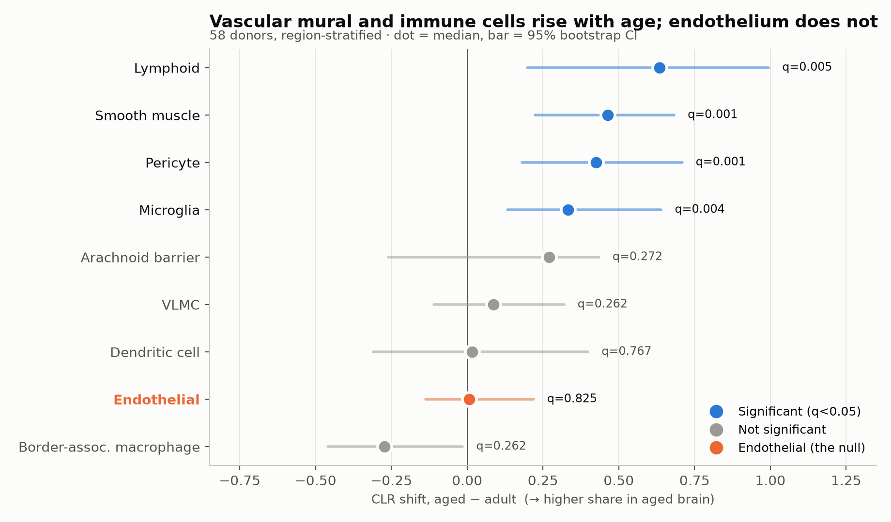
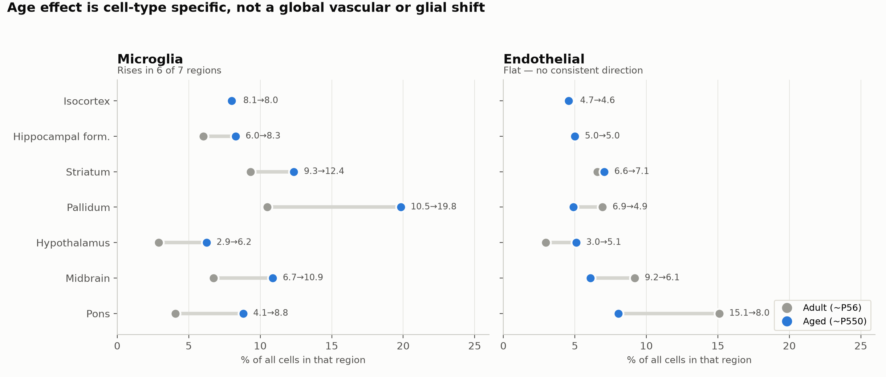
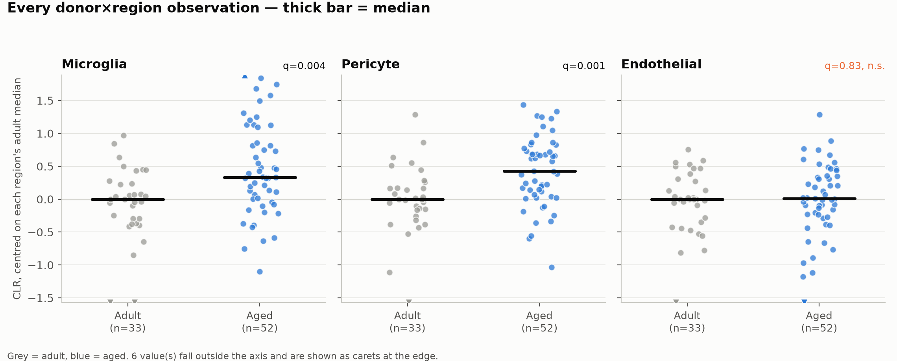
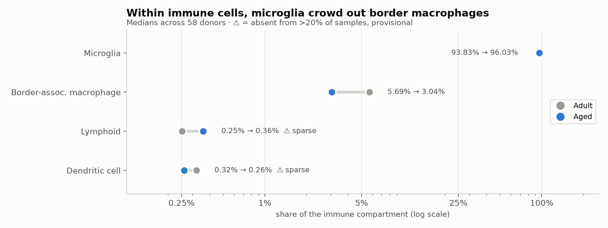

# Does brain cell composition change with age?

Allen Brain Cell Atlas, `Zeng-Aging-Mouse-10Xv3`. This is the dataset with real
biological replication — **108 donors in two age groups** (~P56 "adult" vs
~P550 "aged") — and, as established in `README_spatial.md`, no spatial
coordinates. That trade-off is the reason this is a separate analysis.

```bash
python3 abc_fetch.py --dataset aging-mouse    # 419 MB
python3 aging_composition.py aging_cells.csv
python3 make_figures.py
```

## Headline

**Microglia, pericytes, smooth muscle and lymphoid cells rise with age.
Endothelium does not.**

That last part is the interesting bit. The vascular *wall* changes — mural
cells (pericytes, smooth muscle) go up substantially — while the endothelial
lining stays flat. Aging here is not "the vasculature declines" as a bloc; it
is a specific shift in the mural/endothelial ratio.



| Cell type | CLR shift | Cliff's δ | q (FDR) | |
|---|---|---|---|---|
| Lymphoid | +0.635 | +0.400 | 0.005 | ** ⚠ sparse |
| Smooth muscle | +0.464 | +0.492 | 0.001 | ** |
| Pericyte | +0.425 | +0.465 | 0.001 | ** |
| Microglia | +0.333 | +0.414 | 0.004 | ** |
| Arachnoid barrier | +0.271 | +0.162 | 0.272 | ns |
| VLMC | +0.087 | +0.176 | 0.262 | ns |
| Dendritic cell | +0.017 | +0.054 | 0.767 | ns |
| **Endothelial** | **+0.007** | **+0.029** | **0.825** | **ns** |
| Border-assoc. macrophage | −0.272 | −0.179 | 0.262 | ns |

## Three corrections, without which this analysis is wrong

These are not hygiene footnotes — each one changes the answer.

**1. FACS sorting.** 70 of 108 donors have libraries sorted for `Snap25+
neurons`, which depletes exactly the cells being counted:

| | Endothelial | Microglia |
|---|---|---|
| Unbiased libraries | 6.30% | 8.64% |
| `Snap25+` sorted | 0.51% | 0.32% |
| **Artefact** | **12×** | **27×** |

Only `population_sampling == "unbiased"` is used: 785,769 cells, 58 donors
(26 adult, 32 aged).

**2. Region imbalance.** Regions are not sampled equally across age groups —
midbrain is 25.7% of adult cells but 13.1% of aged; isocortex 18.4% vs 28.2%.
Since non-neuronal fractions vary strongly by region (6.4%–11.3% across
divisions in the MERFISH data), a whole-brain comparison confounds region with
age. Everything is computed **within** region, then combined.

**3. Compositionality.** Proportions sum to 1 within a donor, so they are not
independent: if neurons are lost with age, every non-neuronal fraction rises
mechanically without a single cell being gained. Tests run on centred
log-ratio values. Raw percentages are reported because they are readable, but
the inference is on CLR.

The unit of replication is the **donor**, not the cell. Testing 785,769 cells
as independent would produce microscopic p-values for trivial effects.

## Microglia rise; endothelium does not



Microglia increase in **6 of 7 regions** (ratios 1.32–2.17; only isocortex is
flat at 8.1→8.0%). That consistency across independently-sampled regions is
what makes it credible — more so than the p-value.

Endothelium has no consistent direction: hypothalamus rises (3.0→5.1%),
midbrain and pons fall (9.2→6.1%, 15.1→8.0%), hippocampus and isocortex are
unchanged (5.0→5.0%, 4.7→4.6%). That is what a real null looks like — scatter
around zero, not a uniform flat line.



## Immune composition



Within the immune compartment, microglia go from 93.83% to 96.03% (q=0.035)
and border-associated macrophages fall from 5.69% to 3.04% (q=0.005).

**Read that BAM decline carefully.** Within-compartment shares are
compositional, and microglia are ~94% of the compartment. Their expansion
mechanically pushes everything else down. In the region-stratified CLR
analysis — which does not force a constant sum over the immune subset — BAM
is **not** significant (−0.272, q=0.262). So the honest statement is: *BAMs
decline as a share of immune cells because microglia expand*, not that BAMs
are independently lost. The two analyses disagree because they ask different
questions, and the CLR one is the more conservative.

## What I would not trust

- **Lymphoid is the largest effect and the weakest evidence.** Only 305
  lymphoid cells exist in the whole dataset, and they are absent from 20 of 90
  donor×region samples. With that much zero-inflation the CLR pseudocount does
  real work, and the effect size is sensitive to it. The direction (T-cell
  infiltration of the aged brain) matches the literature, which is reassuring
  but is not independent evidence. Treat as provisional. Dendritic cells
  (242 cells, absent from 22 samples) are worse and came out ns anyway.
- **No single region survives FDR on its own** — 0 of 45 region×celltype
  tests. The effects are only detectable when pooling across regions with
  region adjustment. That is a power statement, not a contradiction, but it
  means per-region claims are not supported.
- **Two age groups, not a gradient.** ~P56 vs ~P550 is a contrast, not a
  trajectory. Nothing here says when a change begins or whether it is linear.
- **Mouse.** ~P550 is roughly a 60-year-old human by convention, but glial and
  vascular aging differ between species.
- **Proportions, not counts.** Nothing here measures absolute cell number per
  brain. A rising fraction is consistent with either gaining that cell type or
  losing others.

## Files

| File | Contents |
|---|---|
| `aging_composition.py` | analysis: filtering, CLR, region stratification, FDR |
| `make_figures.py` | the four figures |
| `results_aging_pooled.csv` | region-stratified overall test per cell type |
| `results_aging_per_region.csv` | all 45 region × cell type tests |
| `aging_immune_props.csv` | per-donor immune compartment shares |
| `aging_donor_region_props.csv` | per-donor × region proportions, all subclasses |
