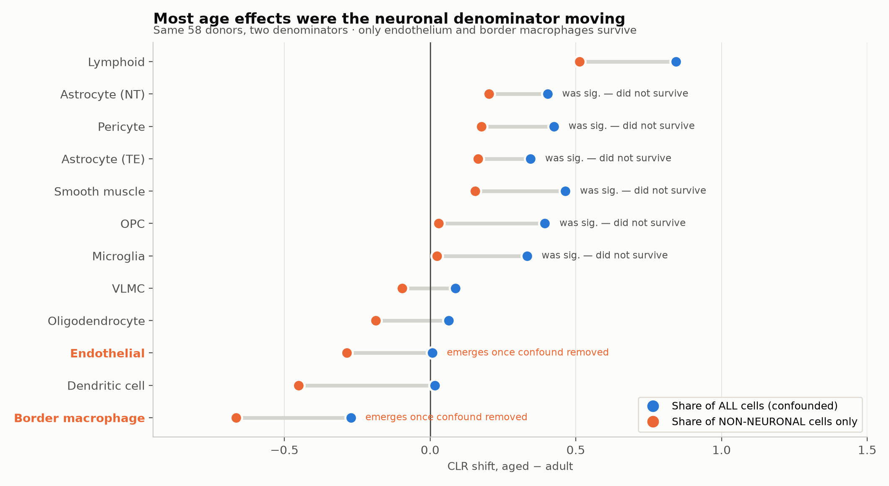

# Does brain cell composition change with age?

Allen Brain Cell Atlas, `Zeng-Aging-Mouse-10Xv3`. 108 donors, two age groups.
This is the dataset with real biological replication and no spatial
coordinates (see `README_spatial.md` for why you cannot have both).

> **Correction.** An earlier version of this file reported that microglia,
> pericytes and smooth muscle rise with age while endothelium stays flat. That
> result does not survive a confound check and has been retracted. The
> corrected finding is close to its inverse: **endothelium and border-associated
> macrophages DECLINE as a share of non-neuronal cells; the microglia /
> pericyte / smooth-muscle increases were the neuronal denominator moving.**
> The superseded numbers are kept below, because the comparison is the point.

## What the data is

| | |
|---|---|
| Assay | 10x Genomics 3′ v3 (1,087,208 cells) and v3.1 (75,357) — **dissociated scRNA-seq** |
| Donors | 108 mice: **64 adult** (median P61, ~2.0 months), **44 aged** (median P544, ~17.9 months) |
| Sex | adult 33M/31F, aged 24M/20F — balanced |
| Genotype | mostly `Snap25-IRES2-Cre;Ai14`, some `Ai14` only, 2 wild-type |
| Regions | 7 anatomical divisions, 16 dissected ROIs |
| Cells used | 785,769 from 58 donors after removing FACS-sorted libraries |

There is no imaging and no tissue here — brains are dissected into ROIs,
dissociated into a cell suspension, and sequenced. Nothing is segmented.

## Are the tissues comparable?

Mostly yes, and I checked rather than assumed:

- **ROI matching: 100%.** Every dissected ROI within all 7 divisions is
  sampled in *both* age groups. There is no region present in one age group
  and absent from the other.
- **Region proportions: not matched.** The *amount* sampled per region differs
  a lot by age (midbrain 25.7% of adult cells vs 13.1% of aged; isocortex
  18.4% vs 28.2%). This is why every test is computed within region.
- **Sex: balanced.** No confound.
- **Genotype: imbalanced, but not driving the result.** `Snap25-Cre;Ai14` is
  20 adult / 18 aged among unbiased donors, `Ai14`-only is 6 / 12. Re-running
  inside the `Snap25-Cre` stratum alone makes the effects *stronger*
  (microglia +0.664, p<0.0001), so genotype is not generating them.
- **Library quality: comparable.** Median genes per neuron 7548 adult vs 7405
  aged. Aged libraries are not degraded.

The one thing that is *not* comparable is what the dissociation recovers —
see below.

## The confound that changed the answer

Neurons are fragile in dissociation and recover differently by age:

| | Adult | Aged |
|---|---|---|
| Neuronal share of unbiased cells | **32.2%** | **24.7%** |
| Median neuronal share per donor×region | 34.1% | 9.5% |

(The two rows differ because the second is a median across samples, and aged
samples are more often non-neuronal-dominated. Both are real; they measure
different things.)

Library quality does not explain it, so this is about which cells survive to
be sequenced. Whether that is purely technical or partly genuine neuron loss
cannot be settled here — **and it does not matter for the correction.**
Proportions are compositional: any drop in the neuronal denominator inflates
every non-neuronal fraction, whether or not a single glial cell was gained.

The fix is to ask a question the confound cannot reach — *within non-neuronal
cells only, does the mix change?* That conditions the denominator away.

| Cell type | Share of ALL cells | Share of non-neuronal only | Verdict |
|---|---|---|---|
| Smooth muscle | +0.464, q=0.002 ✱ | +0.155, q=0.12 | **lost** |
| Pericyte | +0.425, q=0.003 ✱ | +0.176, q=0.13 | **lost** |
| Astrocyte (NT) | +0.403, q=0.009 ✱ | +0.201, q=0.36 | **lost** |
| OPC | +0.394, q=0.007 ✱ | +0.030, q=0.67 | **lost** |
| Astrocyte (TE) | +0.345, q=0.007 ✱ | +0.165, q=0.12 | **lost** |
| Microglia | +0.333, q=0.007 ✱ | +0.024, q=0.51 | **lost** |
| **Endothelial** | +0.007, q=0.83 | **−0.286, q=0.003 ✱** | **emerges** |
| **Border macrophage** | −0.272, q=0.22 | **−0.665, q=0.007 ✱** | **emerges** |

Six of seven "findings" evaporate. Every point moves left, which is the
signature of a shared-denominator artefact rather than eight independent
biological stories.

## What actually changes most with age

Within the non-neuronal compartment, only two survive FDR:

- **Endothelial cells: 10.00% → 7.55%** of non-neuronal cells (−0.286,
  δ=−0.499, q=0.003). A ~25% relative decline.
- **Border-associated macrophages: 0.52% → 0.31%** (−0.665, δ=−0.438,
  q=0.007). A ~40% relative decline.

So the endothelial "null" from the earlier analysis was two effects cancelling:
a real relative decline, masked by the denominator inflation lifting it back to
zero. The vasculature story survives, with the opposite sign to the first pass —
endothelium loses ground relative to other non-neuronal cells, while mural
cells (pericytes, SMC) hold roughly steady. The mural:endothelial ratio still
shifts; it does so by endothelium falling, not mural cells rising.

**Neuronal subtypes** (tested on the all-cell composition, so read with the
confound in mind) decline hardest: `050 Lamp5 Lhx6 Gaba` (−1.484),
`049 Lamp5 Gaba` (−1.055), `036 HPF CR Glut` (−1.000), `053 Sst Gaba`
(−0.802), `046 Vip Gaba` (−0.672) — all q<0.05. Interneuron vulnerability in
aging is a real literature finding, but here it is inseparable from the
dissociation bias, so treat it as a hypothesis, not a result.

## What "pooling across regions" means

It is a statistical operation, not anything to do with cell segmentation —
there is no segmentation in this dataset at all (that was the MERFISH imaging
data in `README_spatial.md`; this is dissociated scRNA-seq, where cells are
physically separated before sequencing).

The problem: the unit of observation is a **donor × region** sample (58 donors
× the regions each was dissected from = 90 observations). Endothelial share
differs by region regardless of age — ~4.7% in isocortex, ~15% in pons. If I
compared all adult samples against all aged samples directly, and aged animals
happened to be sampled more from cortex, I would "discover" an age effect that
is really a region effect.

The fix, in three steps:

1. **Within each region**, compute the adult median for that cell type.
2. **Subtract it** from every observation in that region, adult and aged alike.
   Each region is now centred on its own baseline; the region's absolute level
   is gone, and only the *within-region* adult→aged difference remains.
3. **Pool** the centred values across regions and test once.

Pooling gives statistical power that no single region has — that is the whole
reason to do it, since 0 of 45 individual region × cell-type tests survive FDR
on their own. Centring first is what makes pooling legitimate: without step 2,
pooling would be exactly the confound it is designed to prevent.

## What I still would not trust

- **Two age groups, not a gradient.** ~P56 vs ~P550 is a contrast. Nothing
  here says when a change starts or whether it is linear.
- **Lymphoid.** Largest raw effect, weakest evidence: 305 cells total, absent
  from 20 of 90 samples, and it is not significant once restricted to the
  non-neuronal compartment (q=0.51). Ignore it.
- **No per-region claims.** 0 of 45 region×celltype tests survive FDR alone.
- **The non-neuronal analysis has its own assumption** — that non-neuronal
  types dissociate comparably to *each other*. Weaker than assuming it of
  neurons, but not free. Endothelial cells in particular are known to be
  dissociation-sensitive, so a technical component to their decline cannot be
  excluded from this data alone.
- **Proportions, not counts.** Nothing here measures cells per brain.
- **Mouse.** ~18 months is roughly human 55–60, but glial and vascular aging
  differ by species.

## Files

| File | Contents |
|---|---|
| `aging_composition.py` | primary analysis: filtering, CLR, region stratification, FDR |
| `aging_confound_check.py` | **the correction** — neuronal denominator, non-neuronal re-test |
| `make_figures.py` | all five figures |
| `results_aging_nonneuronal.csv` | corrected, confound-free effects |
| `results_aging_confound.csv` | both analyses side by side |
| `results_aging_all_subclasses.csv` | all testable subclasses incl. neuronal |
| `results_aging_pooled.csv`, `results_aging_per_region.csv` | superseded first pass |

### Superseded figures

`fig1_age_effects.png`, `fig2_region_dumbbell.png` and `fig4_donor_spread.png`
show the **all-cell** composition and therefore carry the confound. They are
kept because `fig5_confound.png` is only interpretable next to them, but their
headline claims are retracted. `fig3_immune_composition.png` (within-immune
shares) is unaffected by the neuronal denominator and still stands.
