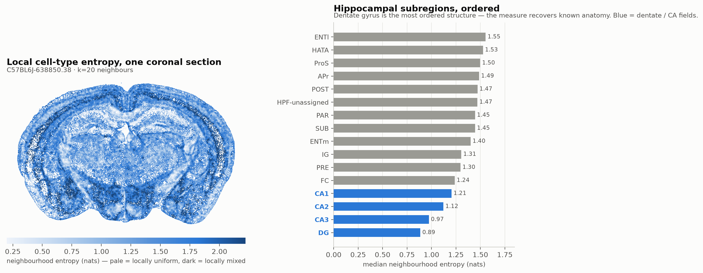
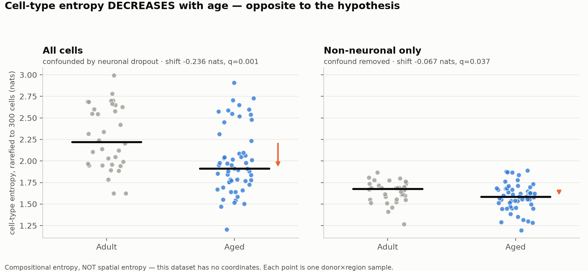

# Does spatial entropy increase with age?

**The direct question cannot be tested with any dataset reachable here, and
the closest testable relative points the opposite way.**

## Why the direct test is impossible

Spatial entropy — how mixed cell types are in a local neighbourhood — needs
per-cell coordinates *and* age variation in the same dataset. Every
spatially-resolved dataset in the Allen Brain Cell Atlas is a single donor,
and each is a different species:

| Dataset | Modality | Donors | Age |
|---|---|---|---|
| MERFISH C57BL6J-638850 | MERFISH | **1** | mouse, adult |
| Xenium CJ23.56.004 | Xenium | **1** | marmoset, 5.7 yr |
| MERSCOPE H22.30.001 | MERSCOPE | **1** | human, 50 yr |
| MERSCOPE QM23.50.001 | MERSCOPE | **1** | macaque, 10 yr |

Contrasting these would confound species with age completely — a mouse-vs-human
entropy difference says nothing about ageing. Meanwhile `Zeng-Aging-Mouse-10Xv3`
has 108 donors and a real age contrast, and is dissociated scRNA-seq: the
coordinates do not exist. This is the same age/space trade-off documented in
`README_spatial.md`, now binding on a specific hypothesis.

So rather than substitute a lookalike and call it an answer, this splits into
three honest pieces.

## A. The instrument, built and validated

`entropy_analysis.py` computes, for every one of 3,739,961 MERFISH cells, the
Shannon entropy of the cell-type composition of its 20 nearest neighbours
**within the same section** (sections are separate physical slices; mixing them
would create "neighbours" millimetres apart in z).

Low entropy = locally homogeneous. High = locally mixed.

It recovers known anatomy, which is the test that matters:

| HPF subregion | Entropy (nats) |
|---|---|
| **DG** | **0.886** — most ordered |
| CA3 | 0.975 |
| CA2 | 1.122 |
| CA1 | 1.205 |
| ENTl | 1.554 — most mixed |

The dentate granule layer is the most homogeneous structure in the
hippocampus, the CA pyramidal fields follow, and entorhinal cortex is the most
mixed. Brain-wide, the lowest values are the ventricles (AQ 0.639, V3 0.895) —
ependymal-lined and dominated by one cell type. Nothing about this ordering was
supplied to the algorithm; it falls out of the coordinates. The measure works
and is ready for data that has both axes.

## B. The testable relative: compositional entropy

Compositional entropy — the diversity of cell types in a sample, with no
geometry — *is* testable in the 108-donor dataset. **It is not spatial entropy**
and is reported as a different quantity, not a proxy.

| Scope | Adult | Aged | Shift | q |
|---|---|---|---|---|
| All cells | 2.222 | 1.912 | **−0.236** | 0.001 |
| Non-neuronal only | 1.677 | 1.584 | **−0.067** | 0.037 |

**Entropy decreases with age — the opposite of the hypothesis.** Aged brain
samples are *less* diverse in cell-type composition, not more.

The all-cells figure is mostly the neuronal-dropout confound from
`README_aging.md`: losing neurons removes many distinct types at once and
mechanically lowers diversity. Restricting to non-neuronal cells shrinks the
effect by 3.5×, to −0.067 nats.

### The estimator trap this had to handle

Shannon entropy is strongly biased by sample size — sample more cells, observe
higher entropy. Adult and aged samples do not contain equal cell counts, so raw
entropy would partly be measuring sequencing depth. Every sample is therefore
**rarefied to exactly 300 cells**, averaged over 30 random draws. Without this
the comparison is partly an artefact of library size.

## C. What a real test would need

Sensitivity of the design that exists:

- Entropy SD across samples: **0.147 nats**
- n = 34 adult / 55 aged donor×region observations
- Smallest difference detectable at ~80% power: **0.090 nats**

The observed non-neuronal effect is **0.067 nats — below that threshold.** So
although it clears q<0.05, this design is underpowered for an effect of the
size actually seen. That is precisely the regime where significant results are
least reliable: at low power, a result that reaches significance has an
inflated effect size and a substantial chance of not replicating. **Treat the
non-neuronal entropy decline as suggestive, not established.** The all-cells
decline is large enough to be safe statistically, but it is the confounded one.

A real test of *spatial* entropy vs age needs an imaging-based dataset
(MERFISH / Xenium / MERSCOPE / CODEX) with **≥6 donors per age group of one
species**, matched regions, and consistent segmentation. Given SD ≈ 0.15 nats
and assuming similar variability for neighbourhood entropy, ~15 donors per
group would detect a 0.1-nat shift comfortably. No such public dataset was
reachable from this environment; the closest candidates are aged-mouse MERFISH
from individual labs rather than an atlas release.

## Interpretation, if the direction holds

A decrease in cell-type diversity with age is not the "tissue becomes
disordered" picture the entropy hypothesis usually assumes. It is consistent
with the composition becoming *more dominated by fewer types* — in this data,
astrocytes and oligodendrocytes hold ~52% of the non-neuronal compartment and
the rarer populations (border macrophages, dendritic cells, endothelium) all
decline. Loss of rare populations lowers entropy even as the tissue becomes
less functionally organised. **Entropy and "disorder" are not the same thing,
and this is a case where they move in opposite directions.**

That is a caution about the hypothesis as posed: spatial entropy going *up*
and compositional entropy going *down* are entirely compatible, because they
measure different things. Only coordinates can settle the first.

## Files

| File | Contents |
|---|---|
| `entropy_analysis.py` | spatial + compositional entropy, rarefaction, power |
| `make_entropy_figures.py` | figures 6 and 7 |
| `results_entropy_spatial_merfish.csv.gz` | per-cell neighbourhood entropy, 3.74M cells |
| `results_entropy_aging.csv` | per donor×region compositional entropy |
| `results_entropy_aging_test.csv` | the age test |
