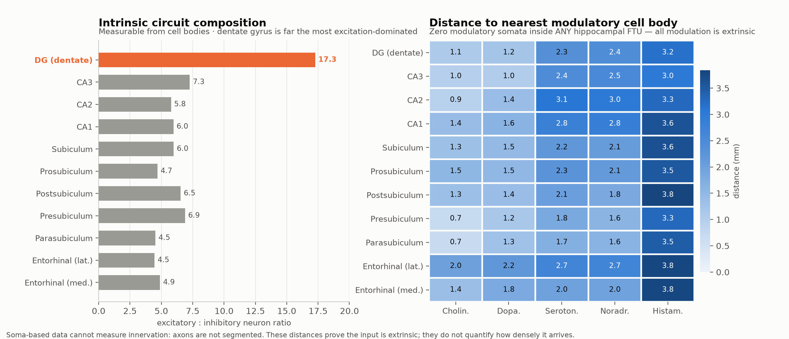

# FTU innervation

## Scope, and the honest limit up front

"FTU" (functional tissue unit) is HuBMAP vocabulary — glomerulus, alveolus,
crypt. **No HuBMAP or Human Reference Atlas host is reachable from this
environment**: `portal.hubmapconsortium.org`, `assets.hubmapconsortium.org`,
`apps.humanatlas.io` and `cdn.humanatlas.io` all fail at the egress proxy.
S3 itself is reachable (guessed bucket names return 404, not 403), but I do not
have valid HuBMAP bucket names and guessing is not a method. So human
peripheral-organ FTUs are unavailable.

The brain equivalent *is* available, and its FTUs are well defined: the
hippocampal subfields DG → CA3 → CA2 → CA1 → subiculum → entorhinal cortex form
the trisynaptic circuit, the canonical functional unit of the hippocampus.

**The bigger limit is modality, not access.** Innervation is axons and
terminals. MERFISH segments and types *cell bodies*. A cholinergic axon
arborising densely through CA1 leaves no cholinergic cell body in CA1 — its
soma sits in the septum, millimetres away. **Any analysis reporting
"modulatory cells per FTU" as an innervation score is measuring the wrong
object.** This is not a caveat bolted on at the end; it determines what the
analysis can claim.

## 1. Intrinsic circuit composition — measurable

Excitatory/inhibitory balance per FTU, computed over neurons only
(non-neuronal cells carry no neurotransmitter label and would otherwise make
the ratio track glial abundance):

| FTU | Neurons | %Glut | %GABA | E/I | GABA subclasses | Interneuron H |
|---|---|---|---|---|---|---|
| **DG** | 29,015 | 94.5% | 5.5% | **17.3** | **28** | **2.14** |
| CA3 | 27,747 | 87.6% | 12.0% | 7.3 | 21 | 1.89 |
| CA2 | 1,696 | 84.4% | 14.6% | 5.8 | 8 | 1.96 |
| CA1 | 31,746 | 85.3% | 14.3% | 6.0 | 14 | 1.92 |
| Subiculum | 8,437 | 85.6% | 14.3% | 6.0 | 19 | 1.77 |
| ENTl | 25,192 | 81.5% | 18.3% | 4.5 | 17 | 1.68 |
| ENTm | 23,436 | 82.9% | 16.9% | 4.9 | 10 | 1.53 |

Two things worth noting:

- **A systematic gradient along the trisynaptic circuit.** E/I falls
  monotonically from DG (17.3) through CA3 (7.3) to CA1 (6.0) and the
  cortical-like entorhinal areas (4.5–4.9). Interneuron *fraction* roughly
  triples from dentate to entorhinal cortex.
- **DG dissociates fraction from diversity.** It has by far the fewest
  interneurons proportionally (5.5%) yet the *richest* repertoire — 28 GABAergic
  subclasses, entropy 2.14, both the highest in the hippocampus. Sparse but
  varied. A single "inhibition" number would have hidden this entirely.

## 2. Is modulatory innervation local? No — and that is quantitative

**Zero modulatory somata (cholinergic, dopaminergic, serotonergic,
noradrenergic, histaminergic) lie inside any hippocampal FTU.** Not "few" —
zero, out of 175,000 hippocampal neurons.

Median distance from each FTU's cells to the nearest modulatory cell body, in
millimetres:

| FTU | Cholin. | Dopa. | Seroton. | Noradr. | Histam. |
|---|---|---|---|---|---|
| DG | 1.1 | 1.2 | 2.3 | 2.4 | 3.2 |
| CA1 | 1.4 | 1.6 | 2.8 | 2.8 | 3.6 |
| ENTl | 2.0 | 2.2 | 2.7 | 2.7 | 3.8 |

For scale, a hippocampal cell body is ~10 µm. The nearest possible modulatory
source is 70–380 cell-diameters away, in a different brain division. So every
bit of aminergic and cholinergic modulation the hippocampus receives arrives
by long-range projection.

## 3. Source nuclei — the upstream half, which somata do capture

The pipeline recovers the correct neuroanatomy without being told any of it,
which is the best available check that the labels and parcellation are joined
properly:

| Modulator | n | Top sources |
|---|---|---|
| Cholinergic | 8,592 | **MH** medial habenula (24.7%), CP striatum (8.0%), VII facial motor (7.1%), **SI** substantia innominata (4.4%) |
| Dopaminergic | 8,352 | MB (17.6%), **MOB** olfactory bulb (15.9%), **VTA** (7.7%) |
| Serotonergic | 2,571 | **DR** dorsal raphe (16.3%), PAG (10.8%), **CS** central superior raphe (8.2%) |
| Noradrenergic | 595 | pons (22.7%), **PB** parabrachial (17.6%), **SLC** locus coeruleus (5.2%) |
| Histaminergic | 221 | **DMH/TU/VMH/LHA** hypothalamic tuberal nuclei (>54% combined) |

Serotonin from the raphe, noradrenaline from locus coeruleus and parabrachial,
histamine from the hypothalamic tuberomammillary region, dopamine from VTA —
these are the textbook sources, recovered from coordinates and transcriptomic
labels alone. The olfactory-bulb dopaminergic population (15.9%) is real too:
periglomerular cells, a large local dopaminergic group unrelated to midbrain
projections, and a good reminder that "dopaminergic somata" is not synonymous
with "midbrain".

## What this does not establish

- **Innervation density.** Nothing here says how strongly any FTU is
  innervated. Distance-to-nearest-soma establishes that input is extrinsic; it
  is not a proxy for terminal density, and should not be reported as one.
- **Which source reaches which FTU.** Projection specificity requires tract
  tracing or axonal labelling. The Allen Mouse Brain Connectivity Atlas has
  this; it is a different dataset and was not reachable here.
- **Human relevance.** Mouse hippocampus. Human FTU innervation differs, and
  the HuBMAP resources that would address it are blocked.
- **The 43% unlabelled cells.** Non-neuronal cells have no neurotransmitter
  label. They are excluded from E/I ratios by design, but a small number of
  genuinely unlabelled *neurons* would be excluded too.

To actually evaluate innervation you need an axonal modality — anterograde
tracing, or an imaging panel targeting terminals (VAChT, TH, SERT, DBH) rather
than somatic identity. That is a different experiment, not a different query
over this data.

## Files

| File | Contents |
|---|---|
| `ftu_innervation.py` | intrinsic E/I, extrinsic distances, source nuclei |
| `make_ftu_figures.py` | figure 8 |
| `results_ftu_intrinsic.csv` | per-FTU circuit composition |
| `results_ftu_extrinsic.csv` | soma counts + distances to each modulator |
| `results_ftu_sources.csv` | source nuclei per modulator |
